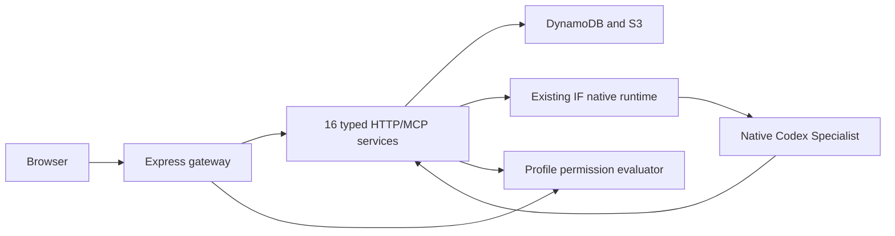
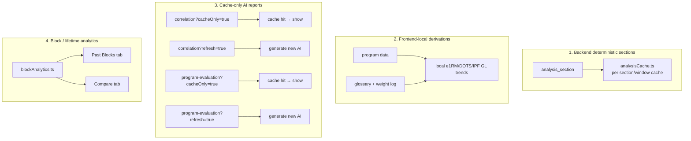
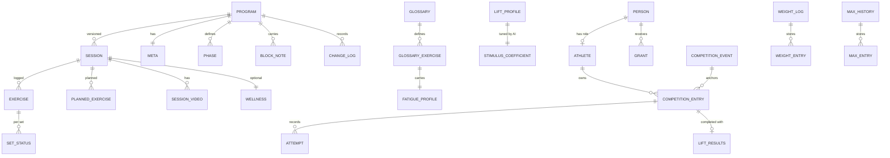
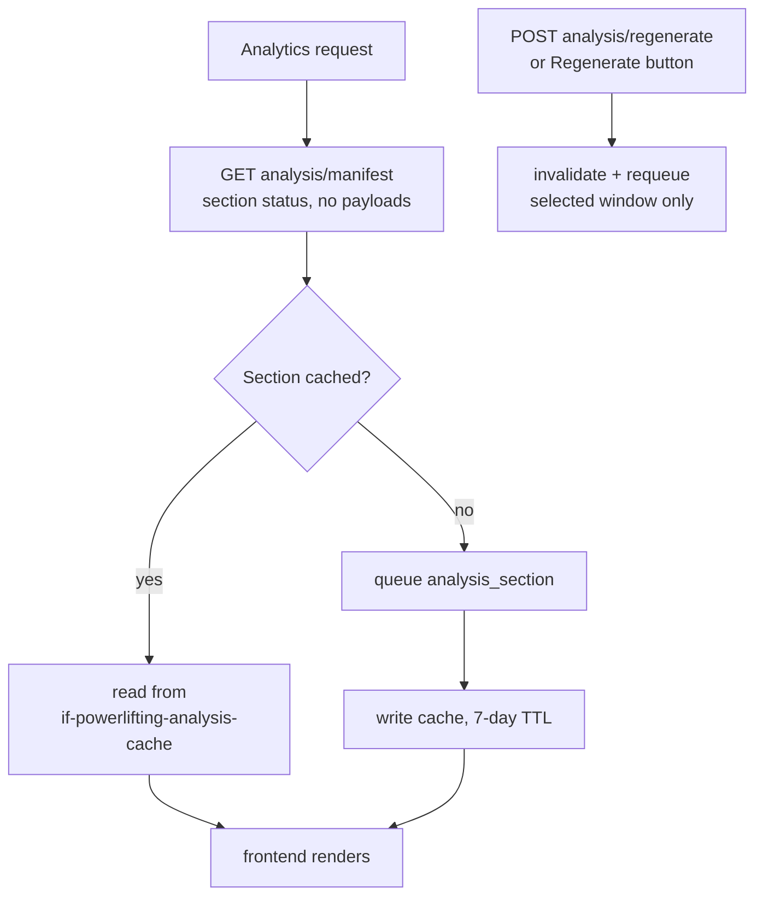
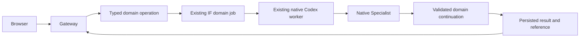

# Architecture

Software and technical deep-dive for the powerlifting portal. For the math, see
[`FORMULAS.md`](./FORMULAS.md). 

## Current request flow

Powerlifting runs in the existing `if-portals` namespace as sixteen domain
Services/Deployments. The operation manifests in `services/operations/*.json`
define typed HTTP and MCP operations. The Express gateway and native Specialists
use these same domain handlers. Retained DynamoDB/S3 stores hold the data.
Fission and direct chat-based tool invocation are retired.

The gateway authentication contract keeps direct Discord login alongside
Authentik OIDC through Passport/openid-client; existing Valkey stores server-side
sessions. The backlog records deployment verification for each provider. Short-lived signed
principals bind acting Person, selected Athlete and operation. The Profile
service evaluates current application permissions with PyCasbin. See ADR-0002
and ADR-0003. These are implementation contracts; the backlog records what has
actually been tested and deployed.

Video upload keeps the existing multipart gateway endpoint. A single request
spools the file with a 500 MiB bound; the backend sends bytes to S3 and confirms
through the existing storage operations. Media reads go through CloudFront (ADR 0004):
thumbnails unsigned, full videos via 72-hour signed URLs issued by `/api`. There is no browser S3 upload, chunk
protocol, second environment or second inference host.

## Analysis page: the four computation paths

`AnalysisPage.tsx` is the analytics hub. It has four top-level section tabs
(Weekly, Blocks, Compare, Maxes) toggled via `?type=`. The Weekly tab alone has
four distinct computation paths:

1. **Backend deterministic sections** — `analysis_section`, queued and cached per
   section/window by `analysisCache.ts`. Current section keys: `overview`,
   `fatigue_readiness`, `peaking`, `workload`, `alerts`.
2. **Frontend-local derivations** — computed in-browser from program data,
   glossary, and the weight log (e.g. local e1RM/DOTS/IPF GL trend cards).
3. **Cache-only-by-default AI reports** — correlation analysis and full-block
   program evaluation load saved references; explicit Generate/Refresh actions
   produce new AI output. Read-only misses return a missing-cache response.
4. **Block / lifetime analytics** — `blockAnalytics.ts` powers the Past Blocks and
   Lifetime Compare tabs.

Max comparisons must use the same method and date range. Historical window
maxima and current Estimated 1RMs have different meanings; for an identical
method and range, the shared lift calculations are authoritative.

## Data model

### Storage

| Store | Backend | Purpose |
|-------|---------|---------|
| `if-health` | DynamoDB | Program document, glossary, max history, weight log, analysis cache refs, AI report caches (ROI/program-eval) |
| `if-sessions` | DynamoDB | Sessions (separate from program; merged by version in `programController.getProgram()`) |
| `if-user` | DynamoDB | Verified provider-subject pointers, Person/profile settings and Athlete mapping |
| `if-powerlifting-analysis-cache` | DynamoDB | Pre-computed window/section/job/block/markdown analytics (7-day TTL) |
| `if-powerlifting-user-competitions` | DynamoDB | Independent Athlete-owned Competition Entries and Attempts |
| `if-powerlifting-master-competitions` | DynamoDB | Master competition directory |
| `if-powerlifting-master-federations` | DynamoDB | Federation library + qualification standards |
| `if-powerlifting-tags` | DynamoDB | Global operator-reviewed vocabulary |
| `if-powerlifting-notifications` | DynamoDB | Durable Person inbox and event deduplication |
| `if-powerlifting-requests` | DynamoDB | Relationships, role slots, favorites, indexed inbox/roster |
| `if-powerlifting-goals` | DynamoDB | Athlete goals |
| `if-powerlifting-budget` | DynamoDB | Budget items + config |
| `powerlifting-session-videos` | S3 | Lift videos (+ thumbnails, + processed) |
| `powerlifting-budget-media` | S3 | Budget item photos |
| `video-thumbnail-generator` | Lambda | S3-triggered ffmpeg thumbnail generation |

### Person and selected Athlete

The guest landing page presents both Discord and Authentik sign-in actions.
Search and About remain separate public pages with navigation back to Home and
Sign in. Discord uses the existing application client and configured
`DISCORD_REDIRECT_URI` at `/api/auth/discord/callback`; Authentik uses its separate
OIDC flow and `/api/auth/authentik/callback`. The Discord button must not be
rerouted through Authentik's Discord source. Both use verified provider subjects
and the shared server-side session store.

Passport and openid-client verify Authentik's issuer and subject. Direct Discord
login obtains its verified subject from Discord's authenticated user API. Valkey stores
server-side login sessions. The identity pointer resolves a stable Person in
`if-user`; `mapped_pk` preserves that Person's existing Athlete partition.
`X-Selected-Athlete-Pk` changes the requested Athlete, never the acting Person.
The Profile service recomputes effective permissions for each HTTP/MCP operation.
Anonymous requests have only explicitly published access; the default operator
selector grants nothing by itself.

Read-only notices follow the current route's domain permissions and are absent
from informational/public navigation pages. Existing navigation carries Athlete
context; the operator rejected a duplicated top context strip. Browser Back from
another Athlete's view must restore the previous context, including on small screens.

### Storage conventions

- Dates are `YYYY-MM-DD`; timestamps are ISO8601.
- Weights are stored in **kilograms**; frontend unit switching is display-only.
- Powerlifting weeks are program/block-defined, not calendar weeks — analysis
  uses stored `block_week_start_days[block]` plus the caller's `asOfDate`.

### Program meta

`Program.meta` carries identity/versioning, timeline, training-week boundaries,
federation/class context, bodyweight, targets, attempt defaults, anthropometrics,
manual maxes, per-block start maxes, program history, template lineage, and
`sex` for DOTS/IPF GL.

### Block and version publication

Blocks have stable identities and editable names. Complete, Start next and the
combined transition require an expected Program revision and idempotency key.
Completing a Block preserves unfinished Session statuses. A new Block captures
its dates, week-start preference and confirmed start maxes, with weeks reset to
one. Template targets preserve logged work and independent Competition Entries.

Setup and version changes stage a unique unpublished Program and its Sessions
before an atomic pointer/publication transaction. Failed staging remains hidden;
retries publish one complete result. Conditional revisions reject stale edits.
Template items and their shared index update atomically, with actor-bound retry
records. Known ownership migrations and fixture copies are additive, conditional
and repeatable; copied operator media references remain read-only.

### Sessions and sets

`Session` holds date/day/week/phase/block, status, planned vs logged exercises,
subjective context (notes, RPE, bodyweight, wellness, pain log), and videos.

`set_statuses[]` is the per-set execution state: `pending | completed | failed |
skipped`. `completed` and `failed` count as executed sets; `skipped` and
`pending` do not contribute to volume, fatigue, INOL, specificity, or muscle-set
totals. `failed_set_reasons[][]` align to `set_statuses[]` (strength/technical/
command/grip/depth/pause/lockout/balance/pain/fatigue/misload tags).

### Lift profiles

Per lift (squat/bench/deadlift): style notes, sticking points, primary muscle,
volume tolerance, `e1rm_multiplier`, `stimulus_coefficient` (with confidence +
reasoning), and INOL low/high thresholds. Used two ways:

1. **Deterministically** — `stimulus_coefficient` modifies INOL.
2. **As AI context** — for lift-profile review/rewrite, stimulus estimation,
   fatigue-profile estimation, correlation, program evaluation, accessory e1RM
   backfill, template evaluation, and import.

## Caching strategy

- Section API keys are window-scoped (`current`, `previous_1/2/4/8`, `block`).
- The legacy `weekly-bundle` endpoint still exists for compatibility/export
  tooling; the Weekly tab reads sections instead.
- AI correlation and program-evaluation reports cache separately and only
  regenerate on explicit refresh (never via the main regenerate endpoint).
- Native report references use a fingerprint of their permitted source snapshot
  and window. Source writes invalidate derived caches. Persisted requirements
  record the source domains and Competition Entry scope; every reference/job
  read checks them against current permissions. Legacy results without source
  requirements are readable only by the Athlete until regenerated.
- Filtered empty source fields remain empty during generation; handlers cannot
  reload private data as a fallback. Read-only cache misses never start inference.
- Historical exports preserve archived Program/Session data and merge independent
  Competition Entries through the same read projection. Exporting does not
  generate a missing AI report.

## AI execution model

The gateway calls the typed domain operation. AI operations submit a domain job
through the existing IF API and native Codex worker. A retained handler requests
inference through `services.ai`; its continuation yields a structured challenge.
The existing native Specialist answers it, and `domain_resume` validates the
response before the handler continues. There is no separate model queue,
OpenRouter fallback, Fission service or second Codex host.

The acting Person and selected Athlete remain distinct throughout submission,
continuation and result reads. The Profile service checks current grants; saved
job results also require access to the domains and competition ties used in
their source. Report deduplication and import review/apply retain their existing
native contracts. Environment variables left in retained AI helpers do not
select a separate inference provider.

### Budget analysis

The current Budget gateway builds permitted Budget items/configuration and
Competition Entries, then calls `budget_priority_timeline` for its deterministic
advice. `budget_advisor` remains a separate typed native AI operation. The current
gateway does not implement the old documented 48-hour advisor cache; this
architecture document does not claim that historical behavior is deployed.

### Budget UX conventions

- **Currency** is a profile-level setting (`settingsStore.currency`, default
  `CAD`), editable from the Settings drawer. It overrides `BudgetConfig.currency`
  across all budget surfaces so the symbol stays consistent.
- **Priority badges** use high-contrast Mantine `filled` variants (MANDATORY =
  blue, IMPORTANT = indigo) and an `outline` gray for OPTIONAL. `light`/`subtle`
  yellow badge backgrounds are avoided — the text is unreadable. Yellow is
  reserved for the read-only "viewing athlete's budget" alert.
- **Mobile navigation** — at ≤560 px the four-tab bar collapses to a single
  `Select` dropdown so every tab stays reachable without horizontal scroll. The
  expense form is single-column on mobile and the date-precision control is a
  dropdown rather than a two-segment control. The collapsed mobile item row hides
  the cost column (shown on expand instead) to keep rows scannable.

## Authentication and publication

Authentik remains available alongside direct Discord login. Application permissions use the Profile
service's PyCasbin evaluator, independent of Authentik's internal RBAC. Every
operation has an explicit permission map and an operation-bound signed principal.
Verified provider subjects preserve existing Person/Athlete mappings; names and
email cannot link accounts. Only an Athlete administers their grants.

Profiles are private by default. Public baseline fields are display name, avatar,
federations and currently approved tags. The Athlete explicitly publishes other
domains through revisioned publication settings. Program, Session, export and
media reads apply current domain permissions. A browser role selector does not
issue grants. Browser caches and drafts use Person/Athlete partitions; online
cached reads contact the service and observed access changes clear the partition.

The selected role determines the current view: Athlete dashboard, Coach roster
or Handler competition-day roster. Multiple memberships do not combine those
screens. Profile/privacy, relationships and inbox are grouped in Settings;
page/display preferences stay in their separate drawer. Tag selection uses
approved pills and one plus-modal search/request field. Pending requests retain
their association and show submission feedback; a pill appears after approval.

Ordinary Program reads fetch current domain state. They do not use the gateway's
former seven-day GET cache, so native domain mutations appear at the same portal
URL immediately. Derived report caches retain their source fingerprints, current
permission checks and write invalidation; offline drafts remain in IndexedDB.

## Video pipeline

The browser sends one multipart request to the existing
`POST /api/videos/:version/:date` route. The backend spools the file with bounded
memory, transfers bytes to S3 and confirms the stored allocation. Storage upload
URLs never reach the browser. Interrupted transfers retry the ordinary request.

The existing S3-triggered worker transcodes and thumbnails videos. Media registry
records bind Athlete, Program version, Session ID, media ID and processing
revision. Generated objects include the revision so stale workers cannot overwrite
newer bytes. The browser loads thumbnails directly from CloudFront and plays videos
through signed CloudFront URLs that `/api` issues after authorization (ADR 0004).

The video limit remains 500 MiB. Lift demonstrations additionally allow at most
three minutes. Cloudflare's request allowance must be upgraded before accepting
the full file size; chunking and browser-direct fallback are excluded.

## Current rough edges

Deliberate or temporary mismatches to be aware of (not all are bugs to fix):

1. Max cards need an explicit method and date range when comparing historical
   achieved loads with current estimates.
2. `attempt_selection` is computed but not rendered on the Analysis page.
3. Program-evaluation gating differs between frontend (≥4 completed sessions)
   and backend (≥4 completed weeks).
4. Template evaluation still passes mocked, minimal athlete context
   (`dots_score=350`, `weeks_to_comp=12`).
5. `TimelinePage.tsx` and `DietNotesPage.tsx` have no registered route.

When you encounter a possible bug, note it in `bug.md` and stay on task — see
[`AGENTS.md`](../AGENTS.md).
