# Architecture

Software and technical deep-dive for the powerlifting portal. For the math, see
[`FORMULAS.md`](./FORMULAS.md). 

## Current request flow

Powerlifting runs in the `powerlifting` namespace as nineteen domain
Services/Deployments, one per operation manifest in
`src/services/operations/*.json`. Each manifest defines typed HTTP and MCP
operations. The Express gateway calls them over the cluster network, and the
Assistant (`pl-assistant`) runs conversational turns and calls them as tools.
The Coach (`pl-coach`) remains the `/v1/jobs` broker and Codex inference
answerer for analytics reports and imports. DynamoDB and S3 hold the data.

The AI workflow (use cases, models, request flow, concurrency, output
validation and hallucination controls) is in the README's
[AI components](../README.md#ai-components) section.

The domain services share the `if-powerlifting-fns` image. The analytics
reports sidecar is built from `docker/powerlifting-analytics.pkr.hcl` into
`if-powerlifting-analytics`.

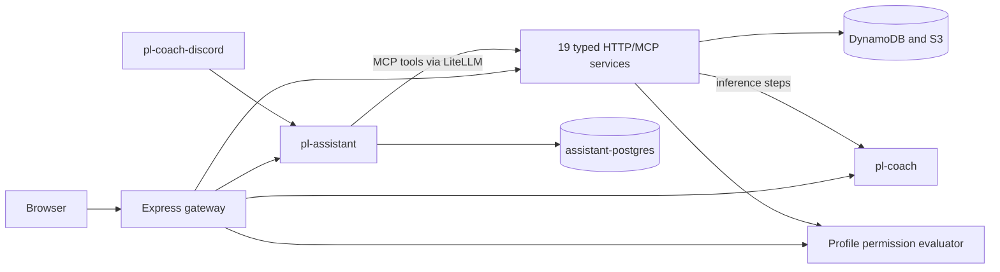

Browser authentication uses OAuth2 Proxy with the existing Authentik OIDC
provider; Discord is an Authentik source. The gateway holds no login session; it
reads the user from the ID token OAuth2 Proxy forwards and resolves the Person
through Profile. Dedicated ServiceAccounts identify workloads through Istio
Ambient mTLS, and per-service AuthorizationPolicies on the shared waypoint decide
which workloads may call which services. Callers state the acting Person in a
header; each domain service authorizes it in-process with Profile/PyCasbin and
current grants at HTTP/MCP boundaries. See ADR-0006.

Video upload keeps the existing multipart gateway endpoint. A single request
spools the file with a 500 MiB bound; the backend sends bytes to S3 and confirms
through the existing storage operations. Media reads go through CloudFront (ADR 0004):
thumbnails unsigned, full videos via 72-hour signed URLs issued by `/api`. There is no browser S3 upload, chunk
protocol, second environment or second inference host.

## Service map

### Entry points and identity

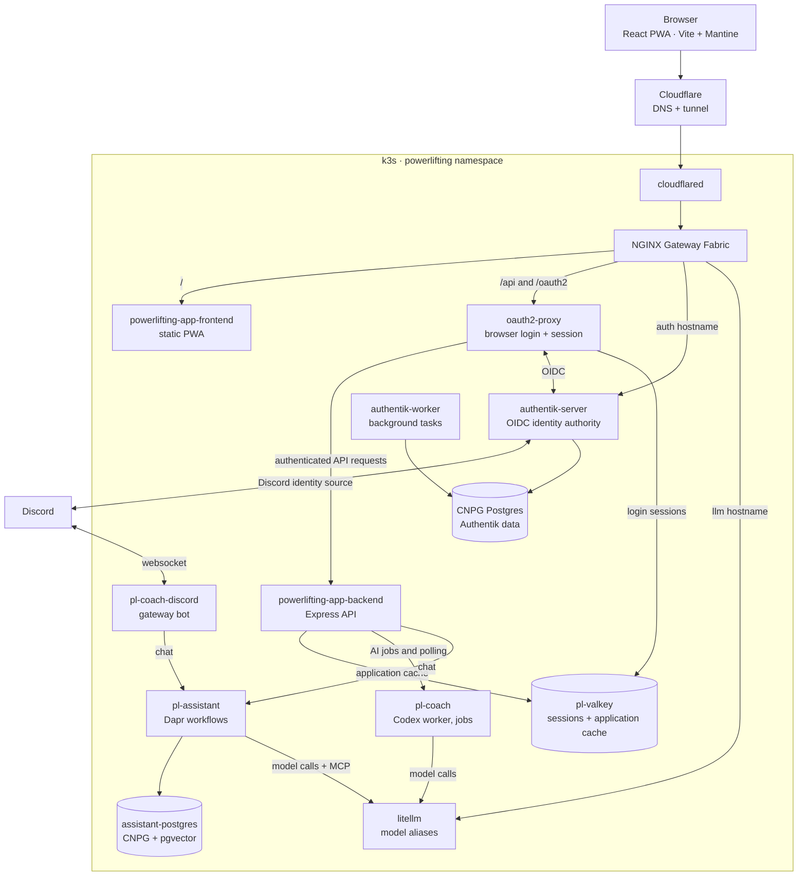

Authentik is the only login authority; Discord is its identity source.
OAuth2 Proxy owns the Valkey-backed browser session and forwards the verified
identity to Express. Express no longer holds a Passport session or a direct
Discord OAuth callback. Both public hostnames pass through NGINX.

### Every domain service

Each box below is a separate service, with typed HTTP operations for the
backend and MCP tools for the Assistant. The four frames organize the inventory
by purpose; they are not shared processes or extra routing layers.

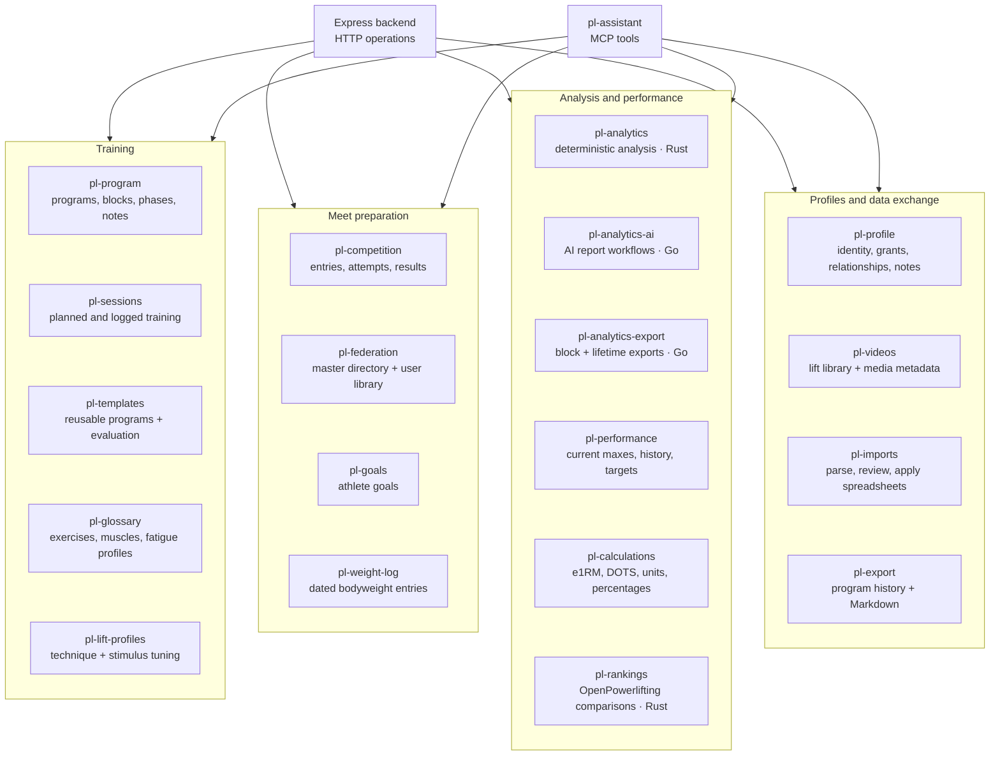

The ten Python services share the `if-powerlifting-fns` image. Analytics
and Rankings have their own Rust images; Analytics AI and Analytics Export
have their own Go images. The old analytics reports sidecar has been replaced
by these separate services.

Every service checks application permissions at its HTTP/MCP boundary using
the current grants and publication settings. `pl-profile` manages those
records; it is not a central authorization hop for every operation.

### Analytics, AI and caches

All model traffic goes through the **LiteLLM layer** at `llm.nolift.training`.
LiteLLM holds the provider credentials (from SSM Parameter Store) and the
ChatGPT subscription login, once. Apps only name **model aliases**
(for example `pl-coordinator`, `pl-responder-fast`, `pl-strong`, `pl-web`,
`pl-embed`, `pl-light`); each alias groups one or more
provider deployments and can fall back to another alias. The admin UI signs in
through Authentik, limited to the users in `litellm_admins`.

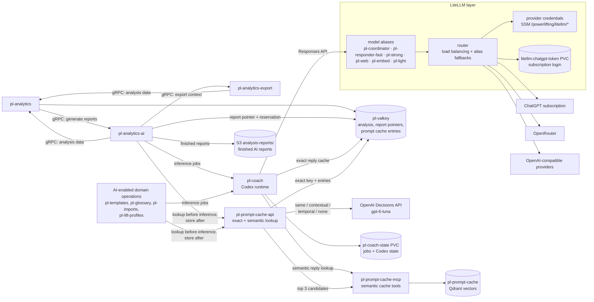

AI-capable operations hand inference to the Coach and resume with its
validated response. The analytics services also exchange computed data over
gRPC; report generation and export run outside the deterministic analytics
process. Every domain AI call, from the Python runtime and from pl-analytics-ai,
asks `pl-prompt-cache-api` before it starts inference and tells it after
inference. I made one service own this so the cache logic exists once and the
callers stay thin. The service checks Valkey for an exact match first. If that
misses, it asks `pl-prompt-cache-mcp` for the top three Qdrant candidates for
that Athlete and operation, then sends them in one request to the OpenAI
Decisions API (`POST /v1/decisions`, model `gpt-6-luna`) so a small model
judges whether a stored answer still holds. Valkey keeps the entries and the
fast report pointers, Qdrant only holds the search index, and S3 holds
finished AI reports. A cache service error never fails an operation; it is
just a miss. Assistant conversations are separate and do not use this cache;
only domain AI operations go through `pl-prompt-cache-api`.

### Storage and media

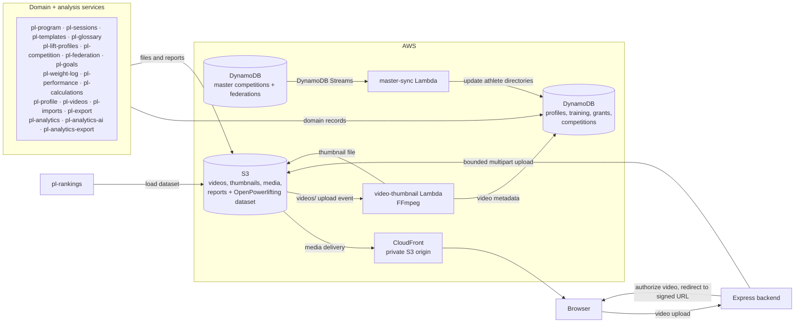

Application data stays in DynamoDB and S3; Postgres is for Authentik.
Thumbnails are served unsigned through CloudFront. Full videos require an
authorized redirect to a signed CDN URL; avatars retain their authorized
API endpoints. The two retained AWS Lambdas generate video
thumbnails and copy master competition/federation updates to athlete directories.

### Mesh, monitoring and deployment

Istio Ambient supplies workload identity and strict mTLS through `ztunnel`.
The `nolift-waypoint` enforces service caller policies; each service still
checks the acting Person's permissions. `istiod` manages the mesh and the
Istio CNI enrolls workloads. These transport controls apply across the service
diagrams above.

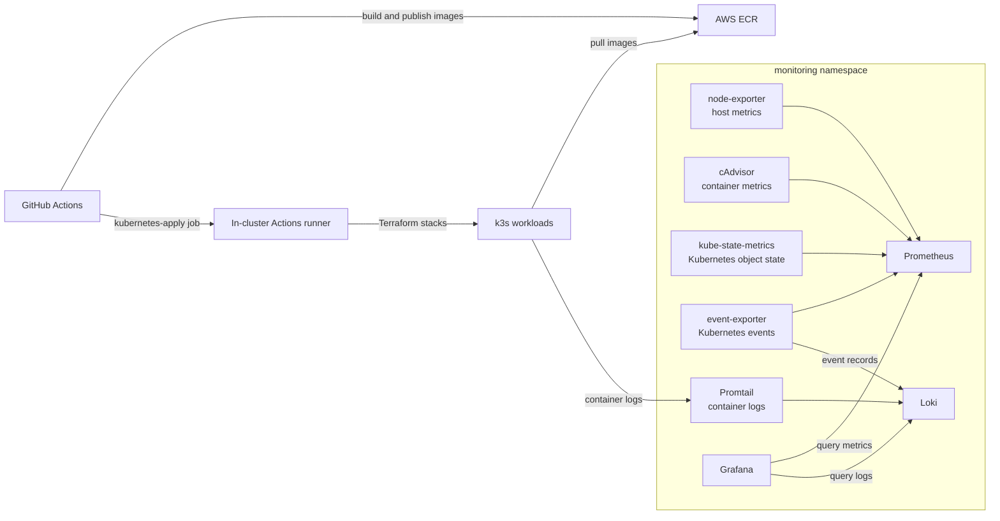

Grafana is reached by port-forward on `localhost:3000`. Infrastructure is
Terraform, with separate states for each scope:

| Location | Scope |
| --- | --- |
| `terraform/` | AWS and Cloudflare resources, applied by CI |
| `terraform/k8s/core` | Namespaces, secrets, runner, Authentik, CNPG Postgres, monitoring |
| `terraform/k8s/perms` | Kubernetes service accounts and RBAC |
| `terraform/k8s/network` | NGINX Gateway, HTTP routes, Cloudflare tunnel |
| `terraform/k8s/mesh` | Istio control plane, CNI and ztunnel |
| `terraform/k8s/app` | Portal, domain services, caches, OAuth2 Proxy, waypoint and service policies |
| `terraform/coach` | Coach, Discord bot and persistent state |

The in-cluster runner applies the Kubernetes stacks and the separate Coach
state after their images are published. See
[`terraform/k8s/README.md`](../terraform/k8s/README.md) for the deployment flow.

## Analysis page: the four computation paths

`AnalysisPage.tsx` is the analytics hub. It has four top-level section tabs
(Weekly, Blocks, Compare, Maxes) toggled via `?type=`. The Weekly tab alone has
four distinct computation paths:

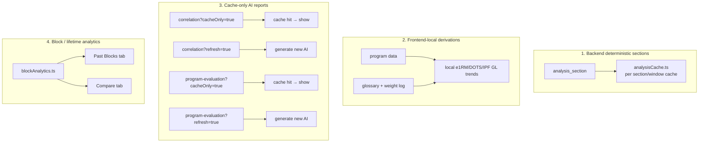

1. **Backend deterministic sections** — `analysis_section`, queued and cached per
   section/window by `analysisCache.ts`. Current section keys: `overview`,
   `fatigue_readiness`, `peaking`, `workload`, `alerts`.
2. **Frontend-local derivations** — computed in-browser from program data,
   glossary, and the weight log (e.g. local e1RM/DOTS/IPF GL trend cards).
3. **Cache-only-by-default AI reports** — correlation analysis and full-block
   program evaluation load saved references; explicit Generate/Refresh actions
   produce new AI output. Read-only misses return a missing-cache response.
4. **Block / lifetime analytics** — `blockAnalytics.ts` powers the Past Blocks and
   Lifetime Compare tabs.

Max comparisons must use the same method and date range. Historical window
maxima and current Estimated 1RMs have different meanings; for an identical
method and range, the shared lift calculations are authoritative.

## Data model

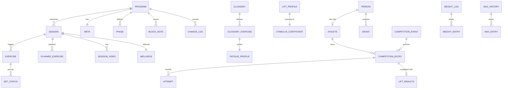

### Storage

| Store | Backend | Purpose |
|-------|---------|---------|
| `if-health` | DynamoDB | Program document, glossary, max history, weight log |
| `if-sessions` | DynamoDB | Sessions (separate from program; merged by version in `programController.getProgram()`) |
| `if-user` | DynamoDB | Verified provider-subject pointers, Person/profile settings and Athlete mapping |
| `if-powerlifting-analysis-cache` | DynamoDB | Legacy and no longer used. It held AI generation records before they moved to S3 and Valkey. The operator deletes it; nothing may read or write it |
| `analysis-reports/{athlete}/{generation_id}.json` | S3 (powerlifting bucket) | Finished AI reports (correlation / ROI, program evaluation, block comparison and any other generation), saved after the calculations. Valkey holds the pointer |
| `pl-valkey` | Valkey | Deterministic analysis sections, block bundles and markdown exports (30-day TTL), ranking percentiles (7-day TTL), and prompt cache keys and entries (`pl:ai-cache:*`, 30-day TTL). AI report pointers (`pl:report:{athlete}:{generation_id}`) have no TTL once complete; in-flight reservations expire after one hour. Also holds the per-Athlete `pl:analysis-version` and `pl:analysis-build` marker |
| `pl-prompt-cache-api` | Go service | Owns the domain AI prompt cache: exact Valkey lookup, Qdrant candidates through the MCP service, one Decisions API call, store after inference |
| `pl-prompt-cache` / `pl-prompt-cache-mcp` | Qdrant (emptyDir) + mcp-server-qdrant | Semantic search index only. Domain AI prompts use one collection per Athlete and operation. Each domain AI point carries an entry id and the entry itself lives in Valkey at `pl:ai-cache:entry:{entry_id}`. Losing it costs semantic hits, never answers |
| `if-powerlifting-user-competitions` | DynamoDB | Independent Athlete-owned Competition Entries and Attempts |
| `if-powerlifting-master-competitions` | DynamoDB | Master competition directory |
| `if-powerlifting-master-federations` | DynamoDB | Federation library + qualification standards |
| `if-powerlifting-tags` | DynamoDB | Global operator-reviewed vocabulary |
| `if-powerlifting-notifications` | DynamoDB | Durable Person inbox and event deduplication |
| `if-powerlifting-requests` | DynamoDB | Relationships, role slots, favorites, indexed inbox/roster |
| `if-powerlifting-goals` | DynamoDB | Athlete goals |
| `powerlifting-session-videos` | S3 | Lift videos (+ thumbnails, + processed) |
| `video-thumbnail-generator` | Lambda | S3-triggered ffmpeg thumbnail generation |

### Person and selected Athlete

The guest landing page presents both Discord and Authentik sign-in actions.
Search and About remain separate public pages with navigation back to Home and
Sign in. Discord uses the existing application client and configured
`DISCORD_REDIRECT_URI` at `/api/auth/discord/callback`; Authentik uses its separate
OIDC flow and `/api/auth/authentik/callback`. The Discord button must not be
rerouted through Authentik's Discord source. Both use verified provider subjects
and the shared server-side session store.

Passport and openid-client verify Authentik's issuer and subject. Direct Discord
login obtains its verified subject from Discord's authenticated user API. Valkey stores
server-side login sessions. The identity pointer resolves a stable Person in
`if-user`; `mapped_pk` preserves that Person's existing Athlete partition.
`X-Selected-Athlete-Pk` changes the requested Athlete, never the acting Person.
The Profile service recomputes effective permissions for each HTTP/MCP operation.
Anonymous requests have only explicitly published access; the default operator
selector grants nothing by itself.

Read-only notices follow the current route's domain permissions and are absent
from informational/public navigation pages. Existing navigation carries Athlete
context; the operator rejected a duplicated top context strip. Browser Back from
another Athlete's view must restore the previous context, including on small screens.

### Storage conventions

- Dates are `YYYY-MM-DD`; timestamps are ISO8601.
- Weights are stored in **kilograms**; frontend unit switching is display-only.
- Powerlifting weeks are program/block-defined, not calendar weeks — analysis
  uses the block record's `week_start_day` plus the caller's `asOfDate`.

### Program meta

`Program.meta` carries identity/versioning, timeline, training-week boundaries,
federation/class context, bodyweight, targets, attempt defaults, anthropometrics,
manual maxes, block records (dates, week start and start maxes), program history, template lineage, and
`sex` for DOTS/IPF GL.

### Block and version publication

Blocks have stable identities and editable names. Each block record carries its
start date, week-start day and start maxes. Complete, Start next and the
combined transition are plain writes. Completing a Block preserves unfinished Session statuses. A new Block captures
its dates, week-start preference and confirmed start maxes, with weeks reset to
one. Template targets preserve logged work and independent Competition Entries.

Setup and version changes stage a unique unpublished Program and its Sessions
before an atomic pointer/publication transaction. Failed staging remains hidden;
retries publish one complete result. Conditional revisions reject stale edits.
Template items and their shared index update atomically, with actor-bound retry
records. Known ownership migrations and fixture copies are additive, conditional
and repeatable; copied operator media references remain read-only.

### Sessions and sets

`Session` holds date/day/week/phase/block, status, planned vs logged exercises,
subjective context (notes, RPE, bodyweight, wellness, pain log), and videos.

`set_statuses[]` is the per-set execution state: `pending | completed | failed |
skipped`. `completed` and `failed` count as executed sets; `skipped` and
`pending` do not contribute to volume, fatigue, INOL, specificity, or muscle-set
totals. `failed_set_reasons[][]` align to `set_statuses[]` (strength/technical/
command/grip/depth/pause/lockout/balance/pain/fatigue/misload tags).

### Lift profiles

Per lift (squat/bench/deadlift): style notes, sticking points, primary muscle,
volume tolerance, `e1rm_multiplier`, `stimulus_coefficient` (with confidence +
reasoning), and INOL low/high thresholds. Used two ways:

1. **Deterministically** — `stimulus_coefficient` modifies INOL.
2. **As AI context** — for lift-profile review/rewrite, stimulus estimation,
   fatigue-profile estimation, correlation, program evaluation, accessory e1RM
   backfill, template evaluation, and import.

## Caching strategy

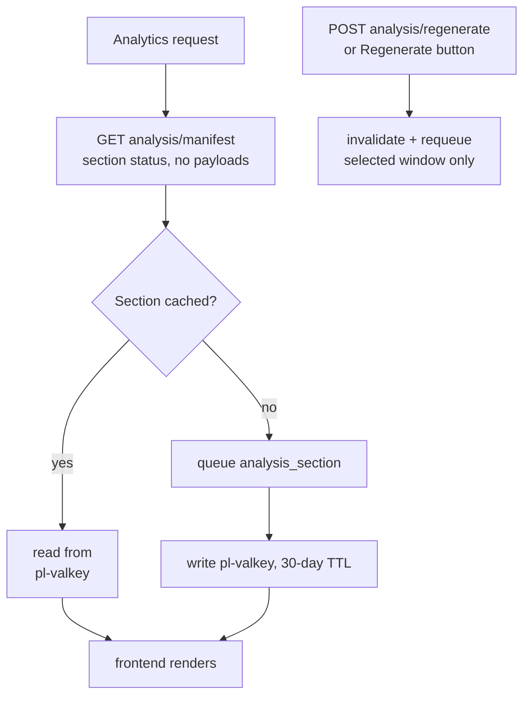

- Section API keys are window-scoped (`current`, `previous_1/2/4/8`, `block`).
- The legacy `weekly-bundle` endpoint still exists for compatibility/export
  tooling; the Weekly tab reads sections instead.
- AI correlation, program-evaluation and block-comparison reports cache
  separately and only regenerate on explicit refresh (never via the main
  regenerate endpoint). Their IDs are stable for the Athlete, report inputs,
  block and access scope: training-data versions, today's date and prompt
  revisions never invalidate a finished report. The current block's start date
  distinguishes it from a later current block. Data changes can make a report
  stale; the Analysis UI's explicit refresh replaces it. This is separate from
  input-sensitive prompt caching for glossary and profile AI features.
  After the calculations, the finished report is saved to
  S3 at `analysis-reports/{athlete}/{generation_id}.json`. Valkey holds a small
  pointer at `pl:report:{athlete}:{generation_id}` and the in-flight
  reservation (`SET NX` with a one-hour TTL). Finished reports and their pointers
  have no TTL. Explicit regeneration replaces the report at the same S3 key;
  bucket versioning can retain previous object versions. If the pointer is gone,
  the read goes to S3 at the known key and restores the pointer. DynamoDB is not
  involved.
- Section and block keys contain the per-Athlete analysis version (plus the
  as-of date for current-block windows). Unchanged data is always a hit; an
  analysis-input write bumps the version, so older entries become unreachable
  and expire after 30 days or are evicted under LRU. When the build id changes,
  analytics sweeps `pl:analysis:*` once on startup.
- Ranking percentiles key on the OpenPowerlifting file identity (name, size,
  mtime), the comparison year, the Athlete, their numbers and the filter.
- Domain AI calls go through `pl-prompt-cache-api` (key from the LiteLLM
  provider keys, `openai`). The lookup order is fixed. First an exact Valkey
  key of Athlete, operation, analysis version and request hash. Then, on a
  miss, the top three Qdrant candidates for that Athlete and operation via
  `pl-prompt-cache-mcp`. Then one OpenAI Decisions API call (`POST
  /v1/decisions`, `gpt-6-luna`) that answers each candidate with one choice:
  `same` (reuse as is), `contextual` (the ask or its data differs, so the
  answer would change), `temporal` (the answer depends on the date and the
  date moved) or `none`. A hit is the first candidate that answers `same` with
  confidence of at least 0.8. Any error, refusal, timeout or missing key is a
  miss, and the caller then runs inference and stores the result. The decision
  is a single bounded call inside the cache service, not a Specialist run with
  tools, so the cache can never block or fail an operation. The old Luna
  Specialist design is gone; do not bring it back.
- Writes to analysis inputs (an allowlist in `services/analysis_version.py`)
  bump a per-Athlete version in Valkey from `dispatch`. The bump targets the
  Athlete the call runs under, not the raw `pk` argument, because a
  person-scoped write such as settings would otherwise bump the Person and
  leave the Athlete's analysis stale. Deterministic section, manifest,
  block and markdown lookups key on that version. Saved AI reports do not:
  only explicit regeneration replaces them. Persisted requirements
  record the source domains and Competition Entry scope; every reference/job
  read checks them against current permissions. Legacy results without source
  requirements are readable only by the Athlete until regenerated.
- Filtered empty source fields remain empty during generation; handlers cannot
  reload private data as a fallback. Read-only cache misses never start inference.
- Historical exports preserve archived Program/Session data and merge independent
  Competition Entries through the same read projection. Exporting does not
  generate a missing AI report.

### Cache design rules

These are rules, not preferences. I keep seeing designs that break them, so
they are written down here.

- Caches live only in Valkey or S3. Never DynamoDB. DynamoDB holds the data
  the caches are computed from, and a cache table there only adds cost and a
  second source of truth.
- Saved Analysis AI reports persist until explicit regeneration, even when
  inputs, dates, prompts or builds change. Reads return the saved report and
  never start inference. A miss means no report exists for that report scope.
  Glossary and profile AI features retain input-sensitive caching.
- Deterministic and prompt caches invalidate outdated entries. They are never
  versioned by a hand-bumped constant in a key or path. Data changes
  invalidate through the Athlete's `pl:analysis-version`, which is bumped on an
  analysis-input write for the Athlete the call runs under. Code changes
  invalidate by build: analytics reads `BUILD_ID` on startup, and when it
  differs from `pl:analysis-build` it sweeps its own `pl:analysis:*` keys once
  (one replica, guarded by a lock) and records the new build. Snapshots carry
  the build id in their body, and a snapshot from another build is treated as
  missing. API fields such as `schemaVersion` stay as response values for the
  frontend; they never appear in a key or path.
- Person to Athlete resolution uses the `mapped_pk` from
  `access_store.current_context`. No ad-hoc user lookups or scans to find an
  Athlete.
- Visitor (signed-out) views read cached results only and never start
  inference. A miss for a visitor stays a miss until the owner generates it.

## Assistant

`pl-assistant` (`src/services/assistant`) is a Go service on Dapr durable
workflows (`durabletask-go`, Dapr 1.18 control plane). Each conversation turn
is a `ConversationTurn` workflow. Every model call, tool call, proposal and
delivery is a checkpointed activity, stored in the pgvector-enabled CNPG
cluster `assistant-postgres`, next to the assistant's own schema
(conversations, turns, participants, embeddings, proposals, audit,
orchestration events). It replaces the old `pl-coach` chat path; `pl-coach`
stays only as the `/v1/jobs` broker and Codex inference answerer for analytics
reports and imports. See ADR-0007 and ADR-0008.

Models are only ever named by LiteLLM alias, with providers registered once:
`pl-coordinator` (ChatGPT subscription, OpenRouter fallback),
`pl-responder-fast` and `pl-strong` (the low and higher delegation tiers),
`pl-web` (OpenRouter web plugin, web research subagent only), `pl-embed` and
`pl-light` (security). The concrete models are tfvars configuration.

### Turn flow

The client only sends the new message; history is held on the server. The
workflow resolves who is asking, screens the message, builds context, then
runs the coordinator model. The coordinator either answers or delegates to
child workflows; there is no classifier gate in front of it. Writes can only
be proposals, which wait for a person.

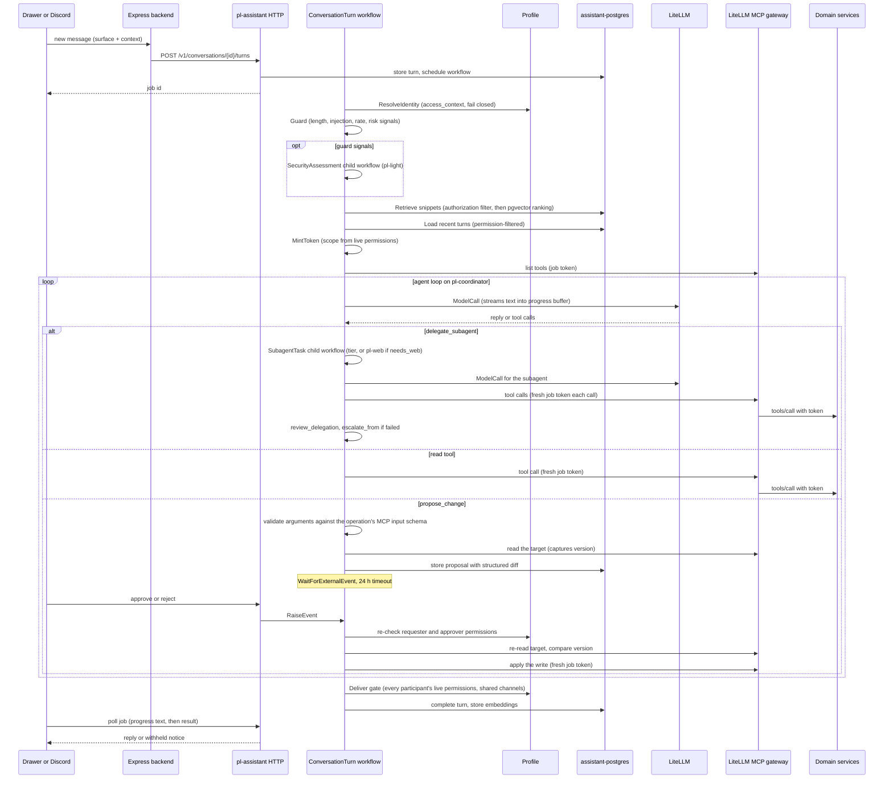

The order inside the workflow is fixed: identity, guard, optional security
assessment, retrieval, history, then the agent loop (`internal/workflow/turn.go`
and `agent.go`). A delegation is a child workflow at the chosen tier; a failed
or empty result is recorded as a failed review and the coordinator can retry
with `escalate_from` on a stronger tier. Model text is streamed into a per-turn
progress buffer in Postgres, which the drawer polls alongside the job status.
Stop terminates the workflow and its children.

### Security

No step trusts the model to say who it is acting for. Identity is resolved
outside the model, narrowed to a scope, and checked again by every service the
tools reach.

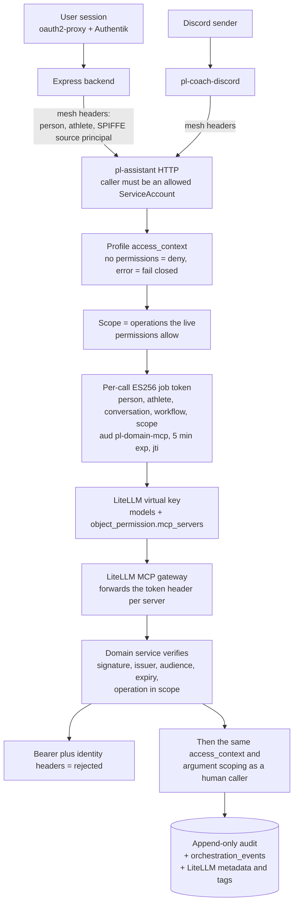

- **Default deny.** No permissions, no scope, an unmapped operation or an
  unverifiable token all end in a denial. A mutating operation is never callable
  from the agent loop; it only runs through an approved proposal.
- **The model never chooses identity or scope.** Person, athlete and scope come
  from Profile; the model only picks among tools already in scope.
- **The security subagent can only tighten.** Its verdict is merged with the
  existing floor (allow, require approval, block) and never grants access.
- **Shared channels.** A result is delivered to a shared Discord conversation
  only if every participant's live permissions cover everything it used;
  otherwise a withheld notice is posted and the event is audited.
- **Approval is re-checked.** Commit re-validates both requester and approver
  permissions, re-reads the target, and refuses a stale version.
- **Audit.** Access decisions, token scope, tool calls, proposals, commits and
  visibility decisions go to the append-only audit table; delegation, review,
  escalation and security decisions go to `orchestration_events`; LiteLLM
  carries per-request metadata and tags. The mesh-header path for non-AI
  callers is unchanged.

### High availability and durability

The service keeps no state of its own. Replicas can be killed, rescheduled or
rolled without losing a turn.

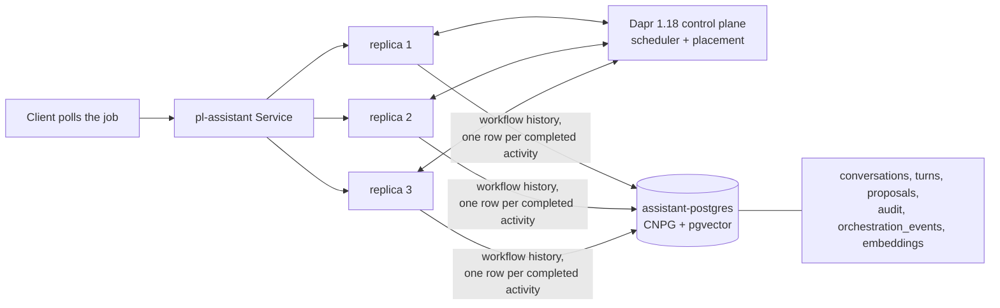

- **Three stateless replicas**, no PVC and no node pinning (2 GiB limit each,
  with a Dapr sidecar).
- **Checkpointed activities.** Each activity result is written to the workflow
  history in Postgres. If a replica is killed or OOMs mid-turn, another replica
  picks the workflow up and replays it to the last completed activity; a model
  call in flight is repeated. This was verified by killing a replica during a
  model call.
- **Durable approvals.** A pending proposal is a `WaitForExternalEvent` with a
  24 hour timeout, so waiting survives restarts and deploys. On timeout the
  proposal expires and nothing is changed.
- **Dapr control plane.** The scheduler and placement services coordinate where
  workflows run. If they are unhealthy, workflows sit in PENDING.
- **One database.** Workflow state and the assistant's own tables share the
  CNPG cluster, so a conversation, its proposals and its audit trail survive
  pod loss together.
- **Tokens are never stored.** A job token is minted inside the activity that
  uses it and lives for five minutes; workflow history holds only the subject
  (person, athlete, scope), not the token.

## AI execution model

This section covers domain AI jobs (analytics reports, imports); chat is the
Assistant above.

The gateway calls the typed domain operation. AI operations submit a domain job
through the `pl-coach` `/v1/jobs` broker and native Codex worker. A retained handler requests
inference through `services.ai`; its continuation yields a structured challenge.
The native Specialist answers it, and `domain_resume` validates the
response before the handler continues. There is no separate model queue,
OpenRouter fallback, Fission service or second Codex host.

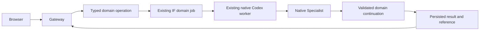

The acting Person and selected Athlete remain distinct throughout submission,
continuation and result reads. The Profile service checks current grants; saved
job results also require access to the domains and competition ties used in
their source. Report deduplication and import review/apply retain their existing
native contracts. Environment variables left in retained AI helpers do not
select a separate inference provider.

## Authentication and publication

Authentik remains available alongside direct Discord login. Application permissions use the Profile
service's PyCasbin evaluator, independent of Authentik's internal RBAC. Every
operation has an explicit permission map and an operation-bound signed principal.
Verified provider subjects preserve existing Person/Athlete mappings; names and
email cannot link accounts. Only an Athlete administers their grants.

Profiles are private by default. Public baseline fields are display name, avatar,
federations and currently approved tags. The Athlete explicitly publishes other
domains through revisioned publication settings. Program, Session, export and
media reads apply current domain permissions. A browser role selector does not
issue grants. Browser caches and drafts use Person/Athlete partitions; online
cached reads contact the service and observed access changes clear the partition.

The selected role determines the current view: Athlete dashboard, Coach roster
or Handler competition-day roster. Multiple memberships do not combine those
screens. Profile/privacy, relationships and inbox are grouped in Settings;
page/display preferences stay in their separate drawer. Tag selection uses
approved pills and one plus-modal search/request field. Pending requests retain
their association and show submission feedback; a pill appears after approval.

Ordinary Program reads fetch current domain state. They do not use the gateway's
former seven-day GET cache, so native domain mutations appear at the same portal
URL immediately. Deterministic caches retain their source fingerprints and write
invalidation. Saved Analysis AI reports retain current permission checks and
change only on explicit regeneration; offline drafts remain in IndexedDB.

## Video pipeline

The browser sends one multipart request to the existing
`POST /api/videos/:version/:date` route. The backend spools the file with bounded
memory, transfers bytes to S3 and confirms the stored allocation. Storage upload
URLs never reach the browser. Interrupted transfers retry the ordinary request.

The existing S3-triggered worker transcodes and thumbnails videos. Media registry
records bind Athlete, Program version, Session ID, media ID and processing
revision. Generated objects include the revision so stale workers cannot overwrite
newer bytes. The browser loads thumbnails directly from CloudFront and plays videos
through signed CloudFront URLs that `/api` issues after authorization (ADR 0004).

The video limit remains 500 MiB. Lift demonstrations additionally allow at most
three minutes. Cloudflare's request allowance must be upgraded before accepting
the full file size; chunking and browser-direct fallback are excluded.

## Current rough edges

Deliberate or temporary mismatches to be aware of (not all are bugs to fix):

1. Max cards need an explicit method and date range when comparing historical
   achieved loads with current estimates.
2. `attempt_selection` is computed but not rendered on the Analysis page.
3. Program-evaluation gating differs between frontend (≥4 completed sessions)
   and backend (≥4 completed weeks).
4. Template evaluation still passes mocked, minimal athlete context
   (`dots_score=350`, `weeks_to_comp=12`).
5. `TimelinePage.tsx` and `DietNotesPage.tsx` have no registered route.

When you encounter a possible bug, note it in `bug.md` and stay on task — see
[`AGENTS.md`](../AGENTS.md).
